<!-- CYBER-TELEMETRY ANIMATED BANNER -->
<a href="https://github.com/Stankewech">
  <picture>
    <source media="(prefers-color-scheme: dark)" srcset="assets/banner-dark.v9.svg">
    <source media="(prefers-color-scheme: light)" srcset="assets/banner-light.v9.svg">
    
  </picture>
</a>

 

<!-- ANIMATED TERMINAL SUBTITLE -->

 

---

## `$ docker ps --format "table {{.Projects}}\t{{.Architecture}}"`

<table width="100%" border="1" cellpadding="14" bgcolor="#090F1E">
  <thead>
    <tr>
      <th width="50%" align="left"><code>◈ 01 // TRAZITOS — AI Educational Platform</code></th>
      <th width="50%" align="left"><code>◈ 02 // 5G-NR PRB TRAFFIC PREDICTION (SIC)</code></th>
    </tr>
  </thead>
  <tbody>
    <tr>
      <td valign="top">
        Plataforma interactiva y backend para evaluación de motricidad fina y trazado de grafías en educación primaria mediante visión artificial.  
        <code>├─ Arch:</code> Red Siamesa + MobileNet + REST API 
        <code>╰─ Stack:</code> <code>Python</code> · <code>FastAPI</code> · <code>TensorFlow</code> · <code>PostgreSQL</code> · <code>Flutter</code>
      </td>
      <td valign="top">
        Modelado y predicción de series temporales para utilización de Physical Resource Blocks (PRB) en redes móviles 5G-NR.  
        <code>├─ Arch:</code> Simulación ns-3 + Ensambles Boosting & Redes MLP 
        <code>╰─ Stack:</code> <code>XGBoost</code> · <code>Scikit-Learn</code> · <code>ns-3</code> · <code>Pandas</code> · <code>Python</code>
      </td>
    </tr>
  </tbody>
  <thead>
    <tr>
      <th width="50%" align="left"><code>◈ 03 // REAL-TIME ML MATCH TELEMETRY API</code></th>
      <th width="50%" align="left"><code>◈ 04 // EMBEDDED NFC & WIRELESS TELEMETRY</code></th>
    </tr>
  </thead>
  <tbody>
    <tr>
      <td valign="top">
        API predictiva de probabilidad de victoria pre-partida con explicabilidad de variables en tiempo real (XAI) conectada a Riot Games API.  
        <code>├─ Arch:</code> Random Forest + SHAP Explainability + FastAPI 
        <code>╰─ Stack:</code> <code>Python</code> · <code>FastAPI</code> · <code>SHAP</code> · <code>Scikit-Learn</code>
      </td>
      <td valign="top">
        Sistemas embebidos con cifrado AES en etiquetas NTAG213, transceptores inalámbricos NRF24L01 y control de periféricos por interrupciones.  
        <code>├─ Arch:</code> Microcontroladores + Cifrado Simétrico AES 
        <code>╰─ Stack:</code> <code>STM32</code> · <code>ESP32</code> · <code>C / C++</code> · <code>NFC</code> · <code>Linux</code>
      </td>
    </tr>
  </tbody>
</table>

---

## `$ cat tech-stack.yaml`

<table width="100%" border="1" cellpadding="14" bgcolor="#090F1E">
  <thead>
    <tr>
      <th colspan="2" align="left"><code>stankewech@upiita-ipn:~$ cat /etc/engineering/tech-stack.yaml</code></th>
    </tr>
  </thead>
  <tbody>
    <tr>
      <td width="50%" valign="top"><code>├─ ⚙ backend_and_databases:</code>  
         
        <code>Python · FastAPI · Flask · SQLModel · SQLAlchemy · PostgreSQL · MySQL</code>
      </td>
      <td width="50%" valign="top"><code>├─ ◉ machine_learning_and_data:</code>  
        
        
         
        <code>TensorFlow · Scikit-Learn · XGBoost · CNNs / Siamese · SHAP · OpenCV · Pandas</code>
      </td>
    </tr>
    <tr>
      <td valign="top"><code>├─ ☁ telematics_networks_and_os:</code>  
         
        <code>5G-NR (ns-3) · Wireshark · Cisco Packet Tracer · Linux · AWS Lambda · Docker</code>
      </td>
      <td valign="top"><code>╰─ ✦ embedded_mobile_and_languages:</code>  
         
        <code>C · C++ · Java · C# · Go · Dart & Flutter · STM32 · ESP32 · LaTeX</code>
      </td>
    </tr>
  </tbody>
  <tfoot>
    <tr>
      <td colspan="2"><code>status: operational&nbsp;&nbsp;·&nbsp;&nbsp;telemetry: active&nbsp;&nbsp;·&nbsp;&nbsp;location: CDMX, México (UTC-6)</code></td>
    </tr>
  </tfoot>
</table>

---

## `$ ./telemetry --render-radars`

  <picture>
    <source media="(prefers-color-scheme: dark)" srcset="assets/radar-dark.svg">
    <source media="(prefers-color-scheme: light)" srcset="assets/radar-light.svg">
    
  </picture>&nbsp;&nbsp;
  <picture>
    <source media="(prefers-color-scheme: dark)" srcset="assets/radar-langs-dark.svg">
    <source media="(prefers-color-scheme: light)" srcset="assets/radar-langs-light.svg">
    
  </picture>

---

## `$ connect --uplink`

&nbsp;&nbsp;
&nbsp;&nbsp;

 

  Ingeniería en Telemática · UPIITA - IPN · Ciudad de México 🇲🇽 · <code>@Stankewech</code>

